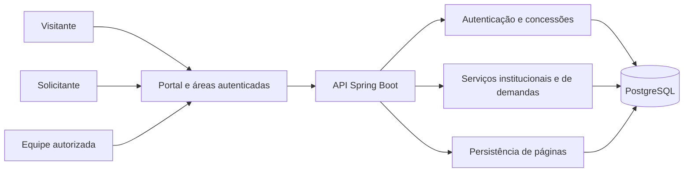

# Arquitetura implementada

## Visão geral

A plataforma ITES adota uma aplicação modular com um frontend, uma API e um banco relacional.

## Responsabilidades

- `web/`: portal institucional, jornadas de solicitantes, administração, editor visual e chamadas à API.
- `server/`: identidade, sessões, concessões, validação de negócio, operações administrativas, auditoria e persistência.
- `database/`: scripts acadêmicos, consultas, rotinas administrativas, privilégios e verificações reproduzíveis.
- `docs/`: requisitos, decisões técnicas, modelo de dados, implantação e validações.

Flyway em `server/src/main/resources/db/migration/` é a única fonte operacional das migrações. Os scripts em `database/coursework/` atendem às atividades acadêmicas e não substituem as migrações da aplicação.

## Identidade e autorização

A autenticação por sessão é compartilhada entre as áreas da plataforma. Os papéis e as concessões são persistidos no PostgreSQL. A afiliação a uma organização não concede acesso administrativo. O backend valida cada operação protegida e restringe demandas ao solicitante proprietário.

O administrador inicial pode ser provisionado uma única vez pelas variáveis `INITIAL_ADMIN_EMAIL` e `INITIAL_ADMIN_PASSWORD`. A conta é marcada como verificada e recebe o papel administrativo sem depender de e-mail; o provisionador não substitui a senha de uma conta preexistente. Com o provedor de e-mail desligado, a administração cria solicitantes pela interface de permissões e a API atribui o papel de solicitante. A confirmação por e-mail do cadastro público permanece opcional e o segundo fator não é obrigatório.

## Portal e editor de páginas

O portal consome a versão publicada das páginas. A administração edita páginas de conteúdo por meio de um catálogo permitido de blocos, propriedades e URLs validadas. Rascunhos são versionados no banco; a publicação e o registro de auditoria são transacionais. O documento persistido não executa código.

Autenticação, formulários de demanda, decisões administrativas e informações pessoais ficam em telas e rotas protegidas. A configuração visual não controla autorização nem substitui validações da API.

## Decisões de arquitetura

| ADR | Decisão |
|---|---|
| ADR-001 | React, Spring Boot, PostgreSQL e Flyway compõem uma aplicação modular. |
| ADR-002 | Identidade, autorização e persistência são compartilhadas entre portal e gestão. |
| ADR-003 | A capacidade do solicitante é informada por demanda, não fixada na conta. |
| ADR-004 | Transições de situação e eventos de auditoria são registrados de forma consistente. |
| ADR-005 | O editor altera somente páginas de conteúdo e blocos validados. |
| ADR-006 | Dados demonstrativos ficam separados da inicialização de produção. |
