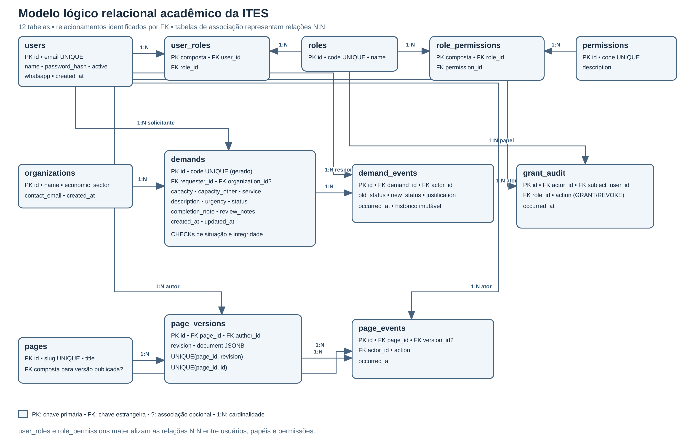

# Documentação técnica do banco de dados

## Contexto e aprovação

A ITES, incubadora associada ao IFRJ Campus Niterói, recebe solicitações de grupos e organizações de economia solidária, acompanha decisões e publica informação institucional. A base relacional preserva pessoas, organizações, demandas, papéis, páginas publicadas e trilhas de auditoria.

O modelo acadêmico desta pasta é executável em PostgreSQL e independente do schema de produção aplicado pelo Flyway em `server/src/main/resources/db/migration/`. Ele não é uma migração concorrente nem é usado pela aplicação. A proposta e o modelo acadêmico precisam ser reconciliados com as 35 tabelas do produto antes de se declarar um único modelo físico final.

O SGBD é PostgreSQL, compatível com a infraestrutura do produto. A validação documentada aqui foi executada em PostgreSQL 16. Os requisitos têm como fonte o [documento de referência da ITES](../requirements/proposta-portal-e-sistema-de-gestao-ites.pdf) (*Proposta de Desenvolvimento do Portal Web e Sistema de Gestão da ITES*).

## Modelo lógico

O modelo contém 12 tabelas. `users` e `organizations` se relacionam com demandas e páginas; papéis e permissões formam relações N:N por tabelas de associação; eventos preservam decisões, concessões e publicações. Imagem exportada: [PNG](logical-model.png) e [SVG](logical-model.svg).



Relacionamentos e cardinalidades:

- `users` 1:N `demands` como solicitante; `organizations` 1:N `demands`, associação opcional por demanda.
- `demands` 1:N `demand_events`; `users` 1:N `demand_events` como responsável.
- `users` N:N `roles` por `user_roles`; `roles` N:N `permissions` por `role_permissions`.
- `pages` 1:N `page_versions`; `users` 1:N `page_versions` como autor. Uma página aponta para no máximo uma versão publicada, pertencente à própria página.
- `pages` 1:N `page_events`; versões e usuários podem aparecer em vários eventos de publicação.
- `users` relaciona-se com `grant_audit` pelos papéis de ator e pessoa que recebeu/perdeu a concessão; `roles` 1:N `grant_audit`.

## Modelo físico e dicionário de dados

Tipos abaixo são PostgreSQL. Campos sem indicação de nulabilidade são `NOT NULL`; datas usam `timestamptz` e padrão `now()` quando indicado.

| Tabela | Colunas, tipos e restrições |
|---|---|
| `users` | `id bigint` identity, PK; `name text`; `email text` UNIQUE; `password_hash text`; `whatsapp text` NULL; `active boolean` DEFAULT `true`; `created_at timestamptz` DEFAULT `now()`. |
| `roles` | `id bigint` identity, PK; `code text` UNIQUE; `name text`. |
| `permissions` | `id bigint` identity, PK; `code text` UNIQUE; `description text`. |
| `user_roles` | `user_id bigint` FK `users(id)` ON DELETE CASCADE; `role_id bigint` FK `roles(id)` ON DELETE CASCADE; PK composta (`user_id`,`role_id`). |
| `role_permissions` | `role_id bigint` FK `roles(id)` ON DELETE CASCADE; `permission_id bigint` FK `permissions(id)` ON DELETE CASCADE; PK composta (`role_id`,`permission_id`). |
| `organizations` | `id bigint` identity, PK; `name text`; `economic_sector text`; `contact_email text` NULL; `created_at timestamptz` DEFAULT `now()`. O setor econômico não representa o serviço solicitado. |
| `demands` | `id bigint` identity, PK; `code text` GENERATED STORED UNIQUE; `requester_id bigint` FK `users`; `organization_id bigint` FK `organizations` NULL; `capacity text`; `capacity_other text` NULL; `service text`; `description text`; `urgency text`; `status text` DEFAULT `Pendente`; `completion_note text` NULL; `review_notes text` NULL; `created_at`, `updated_at timestamptz` DEFAULT `now()`. CHECKs restringem condição, urgência, situação, descrição mínima, descrição de `OTHER` e nota de conclusão. Índices cobrem solicitante/data, situação/data e organização/situação. |
| `demand_events` | `id bigint` identity, PK; `demand_id bigint` FK `demands`; `actor_id bigint` FK `users`; `old_status`, `new_status`, `justification text`; `occurred_at timestamptz` DEFAULT `now()`. CHECKs restringem estados possíveis e exigem justificativa; índices cobrem demanda/data e ator/data. |
| `pages` | `id bigint` identity, PK; `slug text` UNIQUE; `title text`; `published_version_id bigint` NULL; `created_at timestamptz` DEFAULT `now()`. FK composta (`id`,`published_version_id`) aponta para versão da mesma página. |
| `page_versions` | `id bigint` identity, PK; `page_id bigint` FK `pages` ON DELETE CASCADE; `revision integer` CHECK maior que zero; `document jsonb` CHECK objeto; `author_id bigint` FK `users`; `created_at timestamptz` DEFAULT `now()`; UNIQUE (`page_id`,`revision`) e UNIQUE (`page_id`,`id`). |
| `page_events` | `id bigint` identity, PK; `page_id bigint` FK `pages`; `version_id bigint` NULL; `actor_id bigint` FK `users`; `action text` CHECK `PUBLISH` ou `UNPUBLISH`; `occurred_at timestamptz` DEFAULT `now()`. FK composta (`page_id`,`version_id`) impede associar versão de outra página. Índice cobre página/data. |
| `grant_audit` | `id bigint` identity, PK; `actor_id`, `subject_user_id bigint` FK `users`; `role_id bigint` FK `roles`; `action text` CHECK `GRANT` ou `REVOKE`; `occurred_at timestamptz` DEFAULT `now()`. Índice cobre pessoa/data. |

As migrações V1–V23 do produto têm outras entidades do editor e não são substituídas por esse schema acadêmico. O diagrama desta seção corresponde somente aos 12 objetos definidos em `01_schema.sql`.

## Instalação e carga de demonstração

`database/coursework/run_all.sql` é o caminho reproduzível para um banco vazio e dedicado. Ele executa, nesta ordem, schema, rotinas, dados, consultas, validações funcionais, privilégios e testes de segurança. A instalação usa PostgreSQL 16 e psql:

```sh
docker run -d --name ites-db-academico \
  -e POSTGRES_PASSWORD="${POSTGRES_PASSWORD:?Defina uma senha local no ambiente}" \
  -v "$PWD/database/coursework:/coursework:ro" \
  -p 127.0.0.1:55432:5432 postgres:16-alpine
docker exec ites-db-academico createdb -U postgres ites_coursework
until docker exec ites-db-academico pg_isready -U postgres; do sleep 1; done
docker exec ites-db-academico psql -v ON_ERROR_STOP=1 \
  -U postgres -d ites_coursework -f /coursework/run_all.sql
docker rm -f ites-db-academico
```

O comando `pg_isready` pode imprimir tentativas recusadas até o serviço iniciar. A saída real da execução está em [evidence/coursework-validation-postgresql16.txt](evidence/coursework-validation-postgresql16.txt). O arquivo de carga usa somente identidades `example.invalid` e hashes sentinela não autenticáveis.

Todas as 12 tabelas contêm pelo menos 20 linhas, conforme exigido no APD1.

O catálogo de **20 papéis** parte dos quatro perfis do módulo M3 do documento da ITES e detalha as demais responsabilidades do portal, da triagem, do planejamento, dos relatórios e da auditoria:

| Código | Papel | Código | Papel |
|---|---|---|---|
| `REQUESTER` | Solicitante | `REPORT_VIEWER` | Leitor de relatórios |
| `ADMINISTRATOR` | Administrador | `REPORT_EXPORTER` | Exportador de relatórios |
| `DEMAND_MANAGER` | Gestor de demandas | `AUDITOR` | Auditor |
| `COLLABORATOR` | Colaborador | `USER_MANAGER` | Gestor de contas de usuários |
| `TRIAGE_ANALYST` | Analista de triagem | `CONTENT_EDITOR` | Editor de conteúdo institucional |
| `ORGANIZATION_REPRESENTATIVE` | Representante de organização | `CONTENT_PUBLISHER` | Publicador de conteúdo institucional |
| `COORDINATOR` | Coordenação da ITES | `NEWS_EDITOR` | Editor de notícias e agenda |
| `PLAN_MANAGER` | Gestor de planos de atendimento | `PUBLICATIONS_EDITOR` | Editor de publicações |
| `ACTIVITY_RESPONSIBLE` | Responsável por atividades | `PROJECTS_EDITOR` | Editor de projetos e empreendimentos incubados |
| `PARTNERSHIP_MANAGER` | Gestor de parcerias | `SUPPORT` | Suporte técnico |

O catálogo de **20 permissões** cobre perfil (`profile.read_own`, `profile.manage_own`), contas (`users.read`, `users.manage`, `roles.manage`), demandas (`demands.create`, `demands.read_own`, `demands.read`, `demands.review`, `demands.decide`, `demands.cancel`), organizações (`organizations.read`, `organizations.manage`), planejamento (`plans.manage`), relatórios (`reports.read`, `reports.export`), auditoria (`audit.read`) e portal (`portal.content.manage`, `builder.pages.edit`, `builder.pages.publish`). O administrador recebe todas as permissões; cada um dos demais papéis recebe apenas as permissões da sua função (61 associações em `role_permissions`).

## Consultas SQL — APD1

As consultas estão em `database/coursework/03_queries.sql`. Cada comando tem uso operacional:

### Cinco consultas simples

1. **A1** — Demandas pendentes, das mais recentes para as mais antigas: fila de trabalho da triagem.
2. **A2** — Demandas de urgência alta que ainda não foram encerradas: priorização do atendimento.
3. **A3** — Organizações do setor de artesanato: recorte por setor econômico.
4. **A4** — Demandas sem organização vinculada ou com condição "outros" (`IS NULL`, `OR`): casos que exigem atenção na triagem para identificar quem o solicitante representa.
5. **A5** — Páginas publicadas: inventário do conteúdo público do portal.

### Três consultas com JOIN

1. **B1** — Demandas em andamento por organização e situação (`JOIN`, `WHERE`, `GROUP BY`, `count`): volume e andamento por grupo, sem as recusadas e canceladas.
2. **B2** — Decisões registradas por responsável, com o número de recusas (`JOIN` com o histórico, `count`, `FILTER`): distribuição das análises entre a equipe.
3. **B3** — Serviços mais solicitados por setor econômico (`JOIN`, `GROUP BY`, `HAVING count(*) > 1`): diferencia o setor da organização do serviço pedido à ITES.

### Três subconsultas

1. **C1** — `EXISTS`: organizações que têm ao menos uma demanda aceita para atendimento.
2. **C2** — Comparação com subconsulta escalar: solicitantes cujo número de demandas supera a média entre os solicitantes.
3. **C3** — `IN` aninhado: solicitantes com demanda de urgência alta ligada a organizações de artesanato.

As três categorias de consultas são executadas pelo `run_all.sql`. A evidência [`apd1-estrutura-dados-consultas-postgresql16.txt`](evidence/apd1-estrutura-dados-consultas-postgresql16.txt), gerada pelo script `09_apd1_evidencias.sql`, mostra a estrutura de cada tabela, todos os dados inseridos e cada consulta seguida do seu resultado.

## Rotinas e automações — APD2

As definições estão em `database/coursework/04_routines.sql`.

### Funções

| Função | Entrada e saída | Propósito |
|---|---|---|
| `demand_count(text)` | Situação; retorna `bigint` | Conta demandas na situação informada; leitura estável para indicadores. |
| `requester_demand_count(bigint)` | ID do solicitante; retorna `bigint` | Conta as demandas da pessoa indicada; retorna zero para ID sem registros. |
| `published_page_count()` | Sem entrada; retorna `bigint` | Conta páginas com uma versão publicada. |

As funções executam consultas agregadas sem modificar dados. Os testes verificam situação existente e inexistente, solicitante com/sem demandas e contagem antes/depois de retirada de página.

### Procedimentos

| Procedimento | Entradas | Comportamento e atomicidade |
|---|---|---|
| `transition_demand` | Demanda, ator, situação, justificativa e nota opcional | Bloqueia a demanda, atualiza a situação e registra evento na mesma transação. O gatilho e CHECKs validam a transição e a conclusão. |
| `publish_page` | Página, versão, ator | Confirma que a versão pertence à página e publica; o gatilho grava a auditoria na mesma transação. |
| `unpublish_page` | Página, ator | Remove a referência publicada; o gatilho registra a retirada preservando a versão histórica. |
| `assign_role` | Usuário, papel, ator | Concede papel; evento de auditoria é inserido somente se a associação foi criada. |
| `revoke_role` | Usuário, papel, ator | Revoga papel e audita somente se havia associação. |

Os procedimentos de escrita usam `SECURITY DEFINER` com `search_path` fixo. Em PostgreSQL, cada `CALL` é transacional: falha em validação, FK ou trigger desfaz também o registro correspondente de auditoria. Os testes exercitam fluxos válidos e inválidos.

### Gatilhos

| Gatilho | Tabela e evento | Regra |
|---|---|---|
| `transition_guard` | `demands`, antes de atualizar situação | Restringe transições permitidas e atualiza `updated_at`. |
| `event_immutable` | `demand_events`, antes de UPDATE/DELETE | Impede adulterar o histórico de decisão. |
| `page_publish_audit` | `pages`, após alterar versão publicada | Exige ator transacional e registra publicação ou retirada. |

Além dos objetos acadêmicos, a migration operacional `V24__administrator_permission_sync.sql` instala `ites_sync_administrator_permission` e o gatilho `ites_sync_administrator_permission` em `app_permissions`. A migration associa os grants atuais ao papel `ADMINISTRATOR`; cada permissão inserida depois é associada ao papel automaticamente, sem incluir os demais papéis. V25 registra as permissões de organizações, indicadores, dashboards e relatórios; o gatilho aplica esses novos grants na mesma transação.

## Administração, permissões e integridade — APD3

O script `database/coursework/05_security.sql` cria papéis de grupo sem login:

- `ites_runtime`: leitura e escrita operacional; não pode mudar situação diretamente, excluir histórico, administrar schema ou conceder privilégios.
- `ites_reporting`: leitura de uma visão agregada e de funções de métricas; não lê credenciais nem linhas detalhadas de demandas.
- `ites_migration`: privilégios de alteração de schema para execução controlada de migrações.
- `ites_database_admin`: administração dos objetos acadêmicos; não deve ser concedido à aplicação.

O arquivo `database/coursework/08_provision_users.sql` cria contas LOGIN associadas aos quatro grupos com `\password`, que solicita senha sem registrá-la no repositório. Esse provisionamento foi executado interativamente em banco temporário com credenciais descartáveis; os quatro logins autenticaram e seus acessos foram testados. O banco do produto ainda usa a mesma conta para Flyway e runtime; a separação descrita aqui é do modelo acadêmico e continua pendente de aplicação à infraestrutura integrada.

Aplicação, permissões de negócio e papéis do PostgreSQL são camadas diferentes. As permissões da aplicação determinam quem pode decidir demandas; as roles do banco limitam o que uma conexão técnica consegue fazer. Os scripts negam acesso PUBLIC, usam privilégios por coluna/tabela, restringem funções/procedimentos e disponibilizam relatórios somente por agregação. As verificações executam `SET ROLE` para testar acesso autorizado e negações de escrita, leitura sensível, DDL e integridade referencial.

## Evidências, limites e próximos passos

A validação limpa em `postgres:16-alpine` executou criação, carga, as 11 consultas, funções, procedimentos, gatilhos, grants, testes positivos/negativos e contagens. As evidências estão na [transcrição de execução](evidence/coursework-validation-postgresql16.txt) e na [validação das contas LOGIN](evidence/database-users-validation-postgresql16.txt). As contagens finais após smoke de segurança foram: users 30; roles 20; permissions 20; user_roles 45; role_permissions 61; organizations 20; demands 31; demand_events 29; pages 20; page_versions 21; page_events 22; grant_audit 47. O conjunto possui 49 constraints validadas.

Pendências documentadas:

- `database/coursework/` ainda é independente das 35 tabelas físicas da aplicação e não deve ser aplicado no banco operacional.
- As contas LOGIN foram exercitadas somente em banco descartável, com senhas temporárias que não foram preservadas; isso não valida a gestão de segredos de produção.
- O modelo lógico nesta pasta representa o schema acadêmico; falta diagrama abrangente e sincronizado do schema real do produto.
- O runtime da aplicação ainda precisa ser separado da identidade proprietária usada pelas migrações.
- Não há evidência de implantação Dokploy/VPS.
